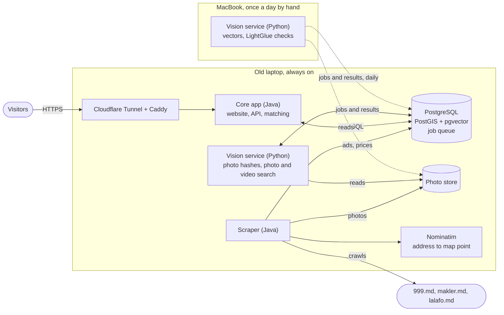

# Apartment Lens

Every flat and house for sale in Moldova on one map. Ads from 999.md, makler.md and other sites are grouped into one card per property, with its price history across all sites. Photo and video search finds the property behind a picture.

> **Status:** design stage. These READMEs describe the plan; there is no code yet.

## Repositories

This repo ties the services together. Each service lives in its own repo, linked here as a git submodule.

| Repo | Path here | Language | Job |
|---|---|---|---|
| [listing-core](https://github.com/mcittkmims/listing-core) | `services/core` | Java | The monolith: website, API, map search, same-flat matching, review screen |
| [listing-scraper](https://github.com/mcittkmims/listing-scraper) | `services/scraper` | Java | Crawls the listing sites, normalizes ads, saves ads, prices and photos |
| [listing-vision](https://github.com/mcittkmims/listing-vision) | `services/vision` | Python | Photo fingerprints, vectors, photo and video search |

The shared database is described in [`database/`](database/README.md).

```
git clone --recurse-submodules https://github.com/mcittkmims/apartment-lens.git
```

## How it fits together



## How it works

1. **The scraper** crawls each site every few hours. It normalizes every ad (price to EUR, rooms, m², floor, address, map point) and saves the ad, a price snapshot when something changed, and any new photos.
2. **The vision service on the laptop** fingerprints each new photo within seconds (SHA-256 and PDQ hash). Copies of the same ad on different sites connect right away.
3. **The core app** matches each new ad against known flats using facts, location, text and photo evidence. It links the ad to a flat, or sends unclear pairs to the review screen.
4. **Once a day you run the vision batch on the MacBook.** It computes vectors for the day's new photos (DINOv2) and checks look-alike photo pairs (LightGlue). The core app then re-matches the day's new ads with that evidence.
5. **Visitors** browse the map and flat pages. A photo or video search goes from the core app through the job queue to the vision service on the laptop, which answers in about a second per photo.

## Design rules

- **Services talk only through the database.** No service calls another over HTTP; work is handed over through the `ops.job` table. The MacBook can be off without breaking anything; its jobs wait.
- **The vision service collects evidence, the core app decides.** Every "same flat?" rule lives in one place.
- **Prefer a missed merge to a wrong one.** Ads are linked to flats with rows that can be undone, never merged destructively.
- **Keep the raw data.** Raw pages are stored so normalization can be re-run when a rule improves.
- **No gateway, broker or Kubernetes.** One public app, one database, Docker Compose on two machines.

## Build order

1. Scraper, price history and map. Start crawling first: price history only exists from the day you start recording it.
2. Grouping by identical photos plus simple rules, then vector search and photo search.
3. Video search.
4. Alerts, more sites, and a matcher trained on review decisions.
