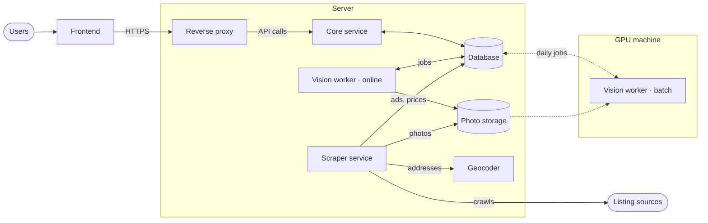
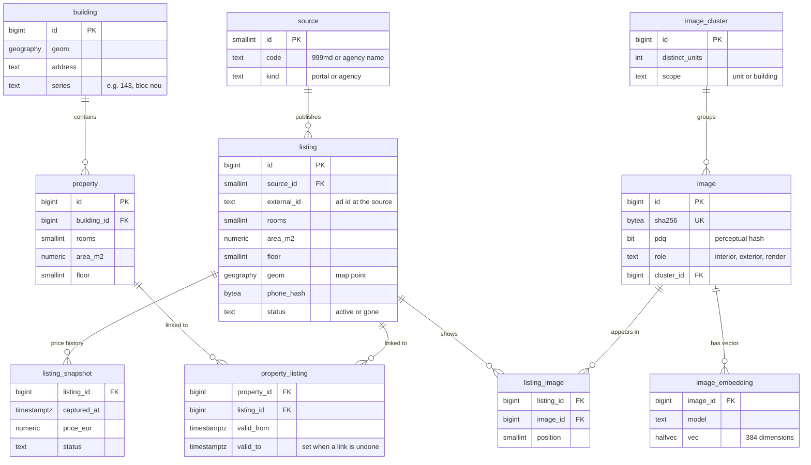

# Apartment Lens

Apartment Lens shows every flat and house for sale in Moldova on one map. It collects ads from 999.md and from real-estate agency websites, recognizes when several ads describe the same property, and groups them into a single property page with the price history from every source. Users can also search with a photo or a video to find the property it shows.

> **Status:** design stage. This repository and the service repositories contain design documents only; there is no code yet.

## Repositories

This repository describes the system as a whole and links the four service repositories as git submodules under `services/`. To clone everything at once:

```
git clone --recurse-submodules https://github.com/mcittkmims/apartment-lens.git
```

| Repository | Language | Responsibility |
|---|---|---|
| [listing-frontend](https://github.com/mcittkmims/listing-frontend) | TypeScript | The website: map, property pages, photo and video search |
| [listing-core](https://github.com/mcittkmims/listing-core) | Java | REST API, search, matching ads to properties, review queue |
| [listing-scraper](https://github.com/mcittkmims/listing-scraper) | Java | Collecting and normalizing ads from 999.md and agency websites |
| [listing-vision](https://github.com/mcittkmims/listing-vision) | Python | Photo fingerprints, image vectors, photo and video search |

## Architecture



Users interact with the frontend, a single-page application that runs in the browser. The browser downloads it from the reverse proxy (Caddy behind Cloudflare Tunnel), which is the only component reachable from the internet. The reverse proxy terminates HTTPS, serves the frontend and photo files, and forwards API calls to the core service.

The core service is a Java application built as a modular monolith. It answers every API call, and it is the only component that decides whether two ads describe the same property. Keeping that decision in one place means every matching rule can be read, tested and changed in one codebase.

Two kinds of background workers fill the database. The scraper service crawls 999.md and the agency websites every few hours, normalizes each ad, and stores the ad, its price changes and its photos. It uses a self-hosted geocoder (Nominatim) to turn addresses into map coordinates when an ad has no map pin. The vision workers process photos. The online vision worker runs on the server, fingerprints each new photo within seconds, and answers photo and video searches. The batch vision worker runs once a day on a separate GPU machine, where it computes image vectors for the day's new photos and checks whether look-alike photos show the same room.

The backend components never call each other directly. They share one PostgreSQL database and hand work to each other through a job table. As a result, the GPU machine can be switched off at any time: its jobs wait in the table until the next run.

## How an ad becomes a property

When the scraper service finds a new ad, it stores the ad and its photos and queues a fingerprint job for each new photo. The online vision worker computes a SHA-256 checksum and a PDQ perceptual hash for each photo; the hash recognizes the same photo even after a source has resized or recompressed it. The core service then compares the new ad with nearby properties using the room count, area, floor, address, phone number and photo fingerprints. Depending on the result, it links the ad to an existing property, creates a new property, or adds the pair to the review queue.

Once a day, the batch vision worker adds stronger evidence. Image vectors (DINOv2) find photos of the same room taken from a different angle, and a geometric check (LightGlue) confirms whether two look-alike photos show the same physical room. After each batch run, the core service re-evaluates the day's new ads with this evidence.

Matching favors precision over recall. A wrong merge would show users a price history that never happened, while a missed merge only shows the same property twice. For this reason every link between an ad and a property can be undone, and ads that disagree on hard facts, such as a known floor, are never merged on photo evidence alone.

## How a photo or video search works

The frontend uploads the file to the core service, which stores it and queues a search job. The online vision worker converts the photo into a vector, finds the nearest listing photos, and groups them by property. For a video, it extracts one sharp frame per shot, searches each frame, and lets the frames vote for a property. The frontend polls the core service until the results are ready, which takes about a second for a photo and under a minute for a video.

## Database

All services share one PostgreSQL database with three extensions: PostGIS for map queries, pgvector for vector search, and pg_trgm for fuzzy text matching. The data is split into six schemas by owner, and each service connects with its own database role that can write only to its own schemas. The diagram shows the core tables.



### `ingest`

The `ingest` schema holds the ads exactly as each source published them. `source` lists 999.md and the agency websites. `listing` has one row per ad per source, with the normalized fields, the map point and a keyed hash of the seller's phone number; the number itself is never stored. `listing_snapshot` gets a new row only when an ad's price or status changes, so it forms the price history. Each snapshot keeps the original price and currency and a EUR value at that day's official BNM exchange rate. `crawl_run` records each crawl with counts of new, changed and failed ads.

### `catalog`

The `catalog` schema holds the system's own view of the market. A `building` contains one or more `property` rows, and each property is one physical flat or house. `property_listing` links ads to properties; instead of deleting a wrong link, the core service sets its `valid_to`, so every grouping decision can be undone and its history is kept. `match_evidence` stores the features and the decision for every pair of ads the core service compared, together with the version of the rules or model that made the decision.

### `media`

The `media` schema holds photos and everything derived from them. `image` has one row per distinct file, identified by its SHA-256, with its PDQ hash and its role (interior, exterior, render, floor plan, map or logo). `listing_image` records which ads show which photo and in which position, because the same photo can appear in several ads. `image_embedding` stores one vector per photo and model, so a new model can be introduced next to the old one. `image_cluster` groups near-identical photos; a cluster used by ads with different floors or areas is marked as building scope, which stops shared facade and render photos from merging different properties. `pair_check` stores the result of each same-room check, so the batch worker never compares the same two photos twice.

### `social`

The `social` schema holds videos submitted for search. `video` stores the link and its metadata, `video_frame` maps the extracted frames to rows in `media.image` so that frames reuse the photo pipeline, and `mention` records which property a video shows.

### `app`

The `app` schema holds user-facing data: `user_account`, `saved_search` (filters and an optional area drawn on the map), `favorite`, `lens_query` (each photo or video search with its results), and `match_report` (reports from users who think two ads were grouped wrongly).

### `ops`

The `ops` schema coordinates the services. `job` is the work queue; a worker claims the next job with `SELECT … FOR UPDATE SKIP LOCKED`, and a lock timeout releases jobs from a worker that stopped mid-run. `review_item` holds the pairs of ads that the core service could not decide on automatically.

### Ownership

| Schema | Written by | Read by |
|---|---|---|
| `ingest` | scraper | core, vision |
| `catalog` | core | core |
| `media` | scraper (photo rows), vision (hashes, vectors, scores) | core, vision |
| `social` | vision, core | core |
| `app` | core, vision (search results) | core |
| `ops` | all services | all services |

The SQL migration files (Flyway) will live in this repository under `database/migrations/` and are applied before the services start.

## Design decisions

The system is a modular monolith with background workers rather than a set of microservices. A single developer maintains it, and microservices would add deployments, network calls and data synchronization without solving a real problem. The components that do run separately have a concrete reason to: the scraper service fails and gets blocked in ways that must not affect the website, and the vision workers need Python and a GPU.

PostgreSQL is the only infrastructure dependency. The job table replaces a message broker, pgvector replaces a separate vector database, and PostGIS and pg_trgm cover map and text search. A cache, search engine or broker can be added later if a measurement shows that the database has become the bottleneck.

Java is used for product logic, where strong typing and a single codebase for matching rules matter most. Python is used only where the image models require it.

## Roadmap

The first milestone is the scraper service for 999.md together with price history and the map, because price history accumulates only from the day crawling starts. The second milestone adds agency websites, grouping by identical photos and simple rules, and then vector search and photo search. Video search follows, and alerts and a matching model trained on review decisions come last.
