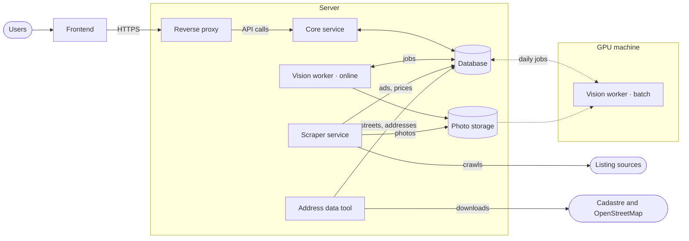

# Apartment Lens

Every flat and house for sale in Moldova on one map. Ads from 999.md and agency websites are grouped into one page per property, with its price history from every source, and users can find a property by searching with a photo or a video.

> **Status:** the scraper collects 999.md and places every ad on the map; the database is in place. The other services are in design.

## Repositories

| Repository | Language | Responsibility |
|---|---|---|
| [listing-frontend](https://github.com/mcittkmims/listing-frontend) | TypeScript | The website: map, property pages, photo and video search |
| [listing-core](https://github.com/mcittkmims/listing-core) | Java | REST API, search, grouping ads into properties |
| [listing-scraper](https://github.com/mcittkmims/listing-scraper) | Java | Collecting and cleaning ads from 999.md and agency websites |
| [listing-vision](https://github.com/mcittkmims/listing-vision) | Python | Photo fingerprints, image vectors, photo and video search |

The service repositories are linked here as submodules under `services/`. Clone everything with `git clone --recurse-submodules https://github.com/mcittkmims/apartment-lens.git`, copy `.env.example` to `.env` with new secrets, and start with `docker compose up -d`. Load the street and address data once, and again every few months to refresh it, with `docker compose run --rm geodata`, then `docker compose restart scraper`.

## Architecture

| Component | Role |
|---|---|
| Frontend | The website, running in the user's browser |
| Reverse proxy | The only public entry point: HTTPS, website and photo files, API calls to the core service |
| Core service | Answers API calls and decides which ads describe the same property |
| Scraper service | Crawls the sources every few hours and stores cleaned-up ads, price changes and photos, each placed on the map from its pin or address |
| Address data tool | Run every few months: loads streets, house numbers and town boundaries from the cadastre and OpenStreetMap, which the scraper uses to place ads |
| Cadastre and OpenStreetMap | The public address data of Moldova |
| Vision worker · online | Fingerprints new photos and answers photo and video searches within seconds |
| Vision worker · batch | Runs once a day on a GPU: image vectors and same-room checks for new photos |
| Database | All data, plus the job queue the services use to hand work to each other |

The backend services never call each other; they only share the database. That is why the GPU machine can be off most of the time: its jobs simply wait in the queue.

## How it works

**New ads.** The scraper stores each new ad and its photos. The online vision worker fingerprints the photos, so copies of the same photo on different sites are found at once. The core service then links the ad to an existing property or creates a new one, and sends unclear cases to a review queue. Once a day, the batch worker adds stronger photo evidence and the core service checks the day's ads again.

**Searches.** A user uploads a photo or video on the website. The online vision worker finds the most similar listing photos and groups them by property; for a video, every frame votes. Results arrive in about a second for a photo and under a minute for a video.

**Photos.** Each photo is downloaded once and kept on the server's disk as a file named by the hash of its content, so a photo shown on several sites is stored once. The scraper and the online vision worker share that folder. The GPU machine reaches the server over a private connection (SSH or a private network, never an open port): once a day it reads its jobs from the database, copies only the photos those jobs name, and writes the results back. Photos keep their link at the source too, so property pages can show either our copy or the original.

## Database

One PostgreSQL database with seven schemas, one per area of the system. Tables, relationships and access rules are described in [database/README.md](database/README.md).

## Roadmap

The 999.md scraper, price history and map come first, because price history only exists from the day crawling starts. Agency websites and photo matching follow, then photo and video search, and finally alerts.
