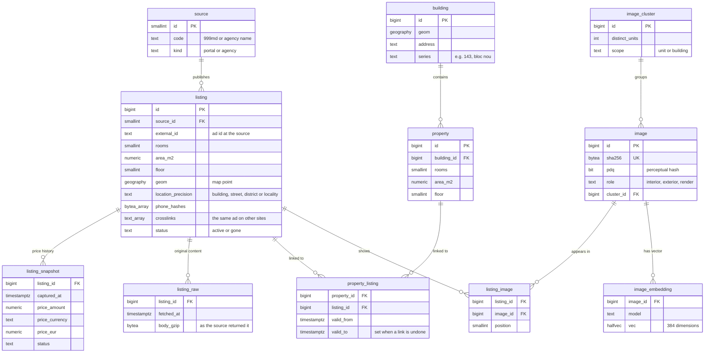

# Database

Apartment Lens uses one PostgreSQL database with PostGIS (map queries), pgvector (vector search) and pg_trgm (fuzzy text matching). The data is split into seven schemas, and each service has a database role that can write only to its own schemas.

## Core tables

## Schemas

| Schema | Tables | Holds | Written by |
|---|---|---|---|
| `ingest` | `source`, `listing`, `listing_raw`, `listing_snapshot`, `crawl_run`, `exchange_rate` | Ads as each source published them and cleaned up, their original content, price history and BNM rates | scraper |
| `catalog` | `building`, `property`, `property_listing`, `match_evidence` | Properties, and which ads belong to each one | core |
| `media` | `image`, `listing_image`, `image_embedding`, `image_cluster`, `pair_check` | Photos, their fingerprints and vectors, and same-room check results | scraper, vision |
| `social` | `video`, `video_frame`, `mention` | Videos submitted for search | vision, core |
| `app` | `user_account`, `saved_search`, `favorite`, `lens_query`, `match_report` | Users, their searches and their reports | core, vision |
| `ops` | `job`, `review_item` | The job queue and the manual review queue | all services |
| `ref` | `admin_area`, `locality`, `street`, `address_point` | Streets, house numbers and boundaries from the cadastre and OpenStreetMap, used to place ads on the map | scraper (imports) |

## Rules

**Price history.** A new `listing_snapshot` row is written only when the price or status changes. Each snapshot keeps the original price and currency plus a EUR value at that day's BNM rate.

**Original content.** `listing_raw` keeps each ad as the source returned it, stored again only when it changes, so the cleaned-up fields can be computed again with better rules. For sites that serve HTML pages it keeps an extract of what describes the property.

**Links between sites.** When a site names its copy of an ad on another site (an agency naming the 999.md ad), `crosslinks` records it, for example `999md:105689225`. The core service uses it as strong evidence that two ads are one property.

**Undoable grouping.** A wrong link between an ad and a property is closed by setting `valid_to`, never deleted, so every grouping decision can be reversed.

**Photos.** One photo can appear in several ads, so photos link to ads through `listing_image`. A near-duplicate cluster used by ads with different floors or areas has `building` scope and never merges two properties.

**Vectors.** Each vector is stored with its model name, so a new model can be added next to the old one.

**Privacy.** The cleaned-up fields hold phone numbers only as keyed hashes; the original content keeps the numbers a site publishes. Private data a site returns but does not publish, such as an owner's phone or an agency's internal notes, is removed before anything is stored.

## Migrations

SQL migrations (Flyway) live in `database/migrations/`. The `migrate` service in Docker Compose applies them before the other services start, and sets each service role's password.
